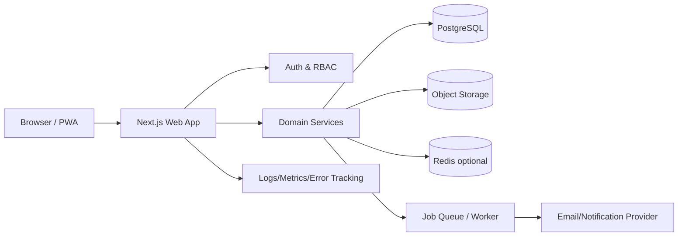
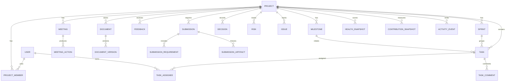

# Capstone OS — Combined Master Specification


---

# Capstone OS — Master Engineering Specification

> نظام ويب Premium لإدارة مشروع التخرج من اختيار الفكرة وحتى المناقشة النهائية.

## الهدف
هذه الحزمة هي المرجع التنفيذي الوحيد للمشروع. يجب أن يتمكن فريق تطوير أو Codex/Claude Code من بناء النظام دون اختراع منطق أعمال أو هوية تصميم من عنده.

## مبادئ المنتج
1. ليس Trello Clone؛ بل **Graduation Project Operating System**.
2. Core functionality لا يعتمد على AI.
3. كل قرار، مهمة، ملف، ملاحظة مشرف، Risk وSubmission يجب أن يكون قابلًا للتتبع Auditably.
4. Mobile-first responsive مع تجربة Desktop قوية لإدارة المشروع.
5. دعم عربي/إنجليزي وRTL/LTR من البداية.
6. Accessibility وSecurity وObservability جزء من Definition of Done.
7. Modular Monolith أولًا؛ لا Microservices بلا حاجة مثبتة.

## الأدوار
- Student
- Team Leader
- Supervisor
- Department Admin (Phase 2)
- System Admin

## الوحدات الرئيسية
Dashboard, Team, Tasks, Sprints, Roadmap, Milestones, Meetings, Supervisor Feedback, Documents, Decisions, Risks, Issues, Project Health, Contribution Analytics, Notifications, Activity Timeline, Submissions, Defense Mode, Settings, Admin.

## ترتيب قراءة الوثائق
ابدأ بـ 01→07 لفهم المنتج والمعمارية، ثم 08→22 للمنطق، 23→27 للواجهة، 28→34 للهندسة التشغيلية، 35→39 للتنفيذ والإطلاق.

## Definition of Done العامة
- Acceptance criteria منفذة.
- Tests ناجحة.
- لا Critical security findings.
- كل action حساس في Audit Log.
- Empty/loading/error/success states موجودة.
- Keyboard navigation وRTL صالحان.
- لا console errors أو unhandled promise rejections.
- لا hard-coded secrets.
- Documentation محدثة مع التنفيذ.


---

# Product Vision & Scope

## الرؤية
Capstone OS هو مركز قيادة رقمي لمشروع التخرج يربط التخطيط والتنفيذ والتوثيق والتواصل مع المشرف والتسليمات في Workspace واحد.

## المشكلة
فرق التخرج عادة توزع العمل بين WhatsApp، Drive، Sheets، Trello، Meetings ورسائل المشرف. النتيجة: قرارات تضيع، نسخ ملفات تتعارض، لا يوجد قياس حقيقي للتقدم، ولا سجل عادل للمساهمة.

## القيمة
- Single source of truth.
- تحويل الخطة الأكاديمية إلى Roadmap قابلة للقياس.
- ربط ملاحظات المشرف بالمهام والإصدارات.
- Project Health مبني على بيانات النظام لا على الانطباعات.
- إثبات Contribution دون مراقبة سلوكية مزعجة.
- Defense readiness قبل يوم المناقشة.

## In Scope — MVP
Authentication, project creation/join, team roles, dashboard, tasks, sprints, milestones, roadmap, meetings, feedback, documents metadata/versioning, decisions, risks/issues, health engine, contribution analytics, notifications, activity log, submission checklists, defense mode, settings, export.

## Phase 2
Department portfolio, supervisor multi-project view, project templates, calendar integrations, Git provider integration, cloud drive integration, advanced reports.

## Out of Scope للنسخة الأولى
- Video conferencing.
- Source code hosting بديل GitHub/GitLab.
- Full LMS.
- Automatic grading.
- AI as a required dependency.
- Payroll/time tracking.

## Success Metrics
- ≥90% من milestones داخل النظام.
- ≥95% من supervisor feedback له status واضح.
- Zero lost decision/feedback records.
- Median dashboard load < 2s في الظروف المستهدفة.
- Team can prepare final defense checklist entirely from system state.


---

# Stakeholders, Roles & Personas

## Stakeholders
Students, team leader, academic supervisor, department coordinator, jury (read-only export only), system administrator.

## Student
يرى المشروع، ينفذ المهام، يضيف updates/files/comments، يسجل الاجتماعات المسموحة، ويراجع feedback.

## Team Leader
كل صلاحيات Student + إدارة team members، assignments، milestones، sprint planning، submissions، project settings، role changes داخل الحدود.

## Supervisor
قراءة تقدم المشروع، إضافة feedback، approve/reject milestones أو submissions، comments، meeting notes. لا يعدل إنجاز الطالب مباشرة إلا بوضوح وصلاحية صريحة.

## Department Admin — Phase 2
إدارة cohorts، supervisors، templates، deadlines العامة، portfolio analytics.

## System Admin
Tenant/system operations، لا يتدخل في المحتوى الأكاديمي إلا support/audit وفق policy.

## Permission Philosophy
- Deny by default.
- Least privilege.
- Project-scoped authorization لكل request.
- Frontend hiding ليس authorization؛ enforcement دائمًا backend/server.
- Sensitive actions require explicit confirmation + audit event.


---

# Functional Requirements

## FR-01 Authentication
- Register/login/logout.
- Email verification optional حسب بيئة الجامعة.
- Password reset.
- Session management.
- Invite-based join to project.

## FR-02 Project Workspace
- Create project: title, code, academic year, department, abstract, start/end dates, supervisor.
- Unique slug.
- Archive/restore.
- Status: Planning, Active, At Risk, Paused, Completed, Archived.

## FR-03 Team
- Invite by email/link.
- Roles and responsibility areas.
- Capacity indicator.
- Member profile with assigned/completed items.

## FR-04 Tasks
- CRUD, status, priority, assignee(s), due date, estimate, labels, dependencies, checklist, attachments, comments.
- Board/List/My Work views.
- Filters, search, bulk edit.
- Blocked reason.

## FR-05 Sprints
- Create sprint, dates, goal, scope.
- Add/remove tasks.
- Start/close sprint.
- Carry-over unfinished work with history.

## FR-06 Roadmap & Milestones
- Phase timeline.
- Milestone criteria, owner, due date, status.
- Evidence attachments.
- Supervisor approval workflow.

## FR-07 Meetings
- Schedule/log meeting.
- Agenda, attendees, notes, decisions, action items.
- Convert action item → task.

## FR-08 Supervisor Feedback
- Feedback title/body/category/severity.
- Link to milestone/task/document/screen.
- Owner, target date, status Open/In Progress/Resolved/Verified.
- Supervisor verification.

## FR-09 Documents
- Folders/tags/categories metadata.
- Upload/download.
- Version history.
- Mark official/final.
- Link document version to submission or feedback.

## FR-10 Decisions
- Decision record: context, options, decision, rationale, owner, date, impacted modules.
- Immutable history of edits.

## FR-11 Risks & Issues
- Risk probability × impact, mitigation, owner, trigger.
- Issues with severity, blocker flag, resolution.

## FR-12 Project Health
- Composite score with transparent breakdown.
- Trend over time.
- Explain drivers and alerts.

## FR-13 Contribution Analytics
- Data from tasks, reviews, documents, meetings/action ownership, decisions.
- No keystroke/activity surveillance.

## FR-14 Notifications
- In-app notification center.
- Preferences by event type.
- Digest mode optional.

## FR-15 Activity Timeline
- Event feed across workspace.
- Filter by entity/member/date.

## FR-16 Submission Center
- Submission definition, deadline, required checklist, required files, owner.
- Readiness percentage.
- Submit snapshot / lock package.

## FR-17 Defense Mode
- Final readiness checklist.
- Presentation sections and owners.
- Demo plan, backup plan, jury questions bank, equipment checklist.
- Read-only presentation-friendly status view.

## FR-18 Search
Global search across tasks, docs metadata, decisions, meetings, feedback, risks.

## FR-19 Export
PDF/CSV/JSON where applicable; audit-safe project summary.


---

# Non-Functional Requirements

## Performance
- LCP target ≤2.5s p75 on normal broadband for key pages.
- API p95 reads ≤500ms for common scoped queries under target load.
- Pagination mandatory for unbounded lists.
- Optimistic UI فقط حين توجد rollback strategy.

## Availability
Target 99.5% for hosted deployment; graceful degradation for noncritical notification/analytics jobs.

## Scalability
MVP target: 5k users, 1k projects, 100 concurrent active sessions. Architecture must scale vertically first and horizontally without schema rewrite.

## Security
OWASP-aligned controls, server-side authorization, secure cookies, CSRF protections where relevant, rate limits, validation, malware/file-type policy, audit logging.

## Privacy
Collect minimum personal data. Contribution metrics explainable. No hidden behavioral surveillance.

## Accessibility
WCAG 2.2 AA target: keyboard, focus, contrast, labels, reduced motion, semantic landmarks, screen reader support.

## Localization
Arabic + English, ICU-style messages, RTL/LTR, locale-aware dates/numbers, no concatenated translated phrases.

## Maintainability
Strict TypeScript, modular domain boundaries, lint/format/test gates, ADRs, no business logic inside visual components.

## Reliability
Idempotent background jobs, transactional writes for multi-entity operations, retry with backoff for transient integrations.

## Browser Support
Latest 2 stable releases of Chromium/Firefox/Safari/Edge; responsive from 360px width.


---

# Information Architecture & User Flows

## Primary Navigation
1. Overview
2. My Work
3. Tasks
4. Roadmap
5. Milestones
6. Meetings
7. Feedback
8. Documents
9. Decisions
10. Risks & Issues
11. Analytics
12. Submissions
13. Defense
14. Activity
15. Settings

## Global Shell
- Left collapsible sidebar desktop.
- Bottom/compact navigation mobile for top 5 destinations + More.
- Project switcher top-left.
- Command/Search trigger.
- Notification center.
- User menu.

## Core Flow — New Project
Sign up → Create Project → basic info → invite team → assign roles → choose project template → define dates → generate default roadmap → Dashboard.

## Core Flow — Daily Student
Login → My Work → open task → update/checklist/comment → attach evidence → mark Ready for Review → reviewer approves → progress recalculated.

## Core Flow — Supervisor Feedback
Supervisor opens project → milestone/document/task → Add Feedback → owner assigned → team resolves → attaches evidence → requests verification → supervisor verifies/reopens.

## Core Flow — Submission
Open Submission → readiness checklist → required artifacts → resolve blockers → create immutable submission snapshot → mark submitted → optional supervisor approval.

## Core Flow — Defense
Defense hub → readiness score → missing items → assign presentation sections → rehearse checklist → freeze final assets → launch presentation mode.


---

# System Architecture

## Architecture Style
**Modular Monolith** داخل Next.js application مع domain services واضحة. هذا أبسط وأكثر موثوقية لمشروع تخرج من microservices، مع إمكانية فصل workers/integrations لاحقًا.



## Layers
- Presentation: routes, layouts, server/client components.
- Application: use-cases/commands/queries.
- Domain: entities, policies, calculations, invariants.
- Infrastructure: DB, storage, email, queue, observability.

## Domain Modules
identity, projects, members, tasks, sprints, roadmap, milestones, meetings, feedback, documents, decisions, risks, health, contribution, notifications, submissions, defense, audit, admin.

## Rules
- Cross-module writes عبر application service وليس direct imports عشوائية.
- DB transactions حول workflows التي تغير أكثر من aggregate.
- Audit event created within same transaction where practical.
- Health/analytics read models يمكن تحديثها async مع freshness timestamp.

## Background Jobs
Email, digest, health snapshot, contribution snapshot, deadline reminders, file post-processing, export generation.


---

# Tech Stack & Engineering Standards

## Baseline Stack
- Next.js 16.x Active LTS.
- React 19.3.
- TypeScript strict.
- Node.js 26 LTS.
- Tailwind CSS 4.x.
- shadcn/ui as open-code component foundation, customized heavily.
- PostgreSQL 18.x stable.
- Prisma ORM 7 stable (do not adopt RC ORM in core without ADR).
- Zod for runtime validation.
- React Hook Form where client forms need it.
- TanStack Table for complex grids where appropriate.
- Playwright E2E.
- Vitest/Jest for unit/integration according to compatibility.
- Docker for local/prod parity.

## Package Manager
pnpm with lockfile committed.

## Code Quality
- ESLint + Prettier.
- noImplicitAny, strictNullChecks.
- import boundaries enforced.
- Conventional Commits.
- Protected main branch.
- PR template requires screenshots for UI changes and test evidence.

## Source Structure
```text
src/
  app/
  components/
  features/
    tasks/
    milestones/
  domain/
  server/
    db/
    auth/
    services/
  lib/
  styles/
  i18n/
  tests/
```

## Engineering Rules
- No data fetching directly from arbitrary presentational components.
- No duplicated permission logic.
- No magic strings for status/roles.
- All mutations validate input and permission server-side.
- Use UTC in storage; render in user/project timezone.


---

# Database Design

## Database
PostgreSQL, UUID primary keys, timestamptz, soft-delete only where product requires restoration. Prefer explicit status over silent deletion.

## Core Tables
users, sessions, projects, project_members, project_invites, phases, milestones, milestone_evidence, sprints, tasks, task_assignees, task_dependencies, task_checklist_items, task_comments, labels, task_labels, meetings, meeting_attendees, meeting_actions, feedback, documents, document_versions, decisions, decision_options, risks, issues, health_snapshots, contribution_snapshots, notifications, notification_preferences, submissions, submission_requirements, submission_artifacts, defense_plans, defense_sections, defense_checklist_items, activity_events, audit_logs.

## Representative Fields
### projects
id, slug, title, code, abstract, academic_year, department, status, start_at, end_at, supervisor_user_id, created_by, created_at, updated_at.

### project_members
project_id, user_id, role, responsibility_title, joined_at, active.
Unique(project_id,user_id).

### tasks
id, project_id, sprint_id?, milestone_id?, parent_task_id?, title, description, status, priority, estimate_points?, due_at?, blocked_reason?, created_by, created_at, updated_at, completed_at?.

### feedback
id, project_id, author_id, assignee_id?, target_type, target_id, category, severity, title, body, status, due_at?, verified_at?.

### document_versions
id, document_id, version_number, storage_key, original_name, mime_type, byte_size, checksum_sha256, uploaded_by, created_at.

### activity_events
append-only event feed for product timeline.

### audit_logs
append-only security/administrative record with actor, action, entity, before/after redacted payload, ip_hash or request metadata according to privacy policy.

## Indexing
- project_id on every project-scoped table.
- composite indexes for (project_id,status), (project_id,due_at), (project_id,created_at desc).
- trigram/full-text index for global search fields as required.
- unique indexes for slug, invite token hash, document version per document.

## Data Integrity
- Foreign keys.
- Check constraints for probability/impact/score ranges.
- Transactional sequence for document versions.
- Never store raw invite/reset tokens; store hashes.


---

# ERD



## Relationship Rules
- كل entity operational تقريبًا project-scoped.
- document_version لا يتغير بعد إنشائه؛ upload جديد = version جديد.
- submission artifact يشير إلى version محدد وليس document mutable.
- health snapshot immutable historically.
- activity_event append-only.


---

# API Specification

## Style
Internal JSON API تحت `/api/v1`. Server Actions يجوز استخدامها للـUI، لكن domain service هو المصدر المشترك للمنطق. Public contracts versioned.

## Response Envelope
```json
{ "data": {}, "meta": {"requestId":"..."} }
```
Errors:
```json
{ "error": {"code":"TASK_NOT_FOUND","message":"...","fields":{}}, "meta":{"requestId":"..."} }
```

## Key Endpoints
### Projects
GET /projects
POST /projects
GET /projects/:projectId
PATCH /projects/:projectId
POST /projects/:projectId/archive

### Members
GET /projects/:id/members
POST /projects/:id/invites
PATCH /projects/:id/members/:userId
DELETE /projects/:id/members/:userId

### Tasks
GET /projects/:id/tasks?status=&assignee=&sprint=&q=
POST /projects/:id/tasks
GET /projects/:id/tasks/:taskId
PATCH /projects/:id/tasks/:taskId
POST /projects/:id/tasks/:taskId/comments
POST /projects/:id/tasks/:taskId/transition

### Sprints / Milestones
CRUD + start/close sprint; approve/reject milestone.

### Feedback
CRUD, resolve, request-verification, verify, reopen.

### Documents
POST init-upload → signed upload/stream → POST complete-upload.
GET versions.
POST mark-official.

### Health
GET /projects/:id/health
GET /projects/:id/health/history
POST /projects/:id/health/recompute (leader/admin internal).

### Submissions
CRUD, readiness, freeze, submit, approve.

## Pagination
Cursor-based for activity/comments/notifications; offset acceptable for bounded admin tables.

## Concurrency
Use updated_at/version field for optimistic concurrency on frequently edited records. Return 409 EDIT_CONFLICT with latest entity.

## Idempotency
Freeze submission, invite send, and external-triggered mutations support idempotency keys.


---

# Authentication, RBAC & Permissions

## Authentication
Cookie-based secure sessions preferred for web app. Cookies: HttpOnly, Secure in production, SameSite=Lax/Strict according to flow. Rotate session on sensitive auth events.

## Authorization Model
Global role + project role + entity policy.

## Matrix (summary)
| Action | Student | Leader | Supervisor | Dept Admin |
|---|---:|---:|---:|---:|
| View project | ✓ | ✓ | ✓ | ✓ |
| Create/edit own task update | ✓ | ✓ | comment | ✓ |
| Assign team tasks | limited | ✓ | suggest | ✓ |
| Manage members | ✗ | ✓ | ✗ | ✓ |
| Add supervisor feedback | ✗ | ✗ | ✓ | ✓ |
| Resolve feedback | ✓ | ✓ | verify | ✓ |
| Approve milestone | ✗ | request | ✓ | ✓ |
| Freeze submission | ✗ | ✓ | optional | ✓ |
| Project settings | ✗ | ✓ | limited | ✓ |

## Policies
- `canViewProject(user, project)`
- `canManageTask(actor, task)`
- `canApproveMilestone(actor, milestone)`
- `canAccessDocument(actor, document)`
- `canManageMembers(actor, project)`

## Invite Security
Random high-entropy token; store only hash; expiration; max use; revoke; rate limit.

## Sensitive Actions
Role change, member removal, project archive, submission freeze require confirmation and audit log.


---

# Project Workspace & Team Module

## Workspace Header
Project title, short code, status, health badge, academic period, supervisor, quick actions.

## Project Settings
General info, dates, timezone, locale, grading/phase template, archive, export.

## Member Model
name, avatar, role, responsibility area, current capacity indicator, active task count, due-soon count, completed this sprint.

## Invitation Flow
Leader enters email → invite created → email/link → recipient authenticates → accepts → membership created → activity/audit event.

## Responsibilities
Role ≠ responsibility. Example: role=Student; responsibility=`Backend Lead` or `Documentation Owner`.

## Capacity
Do not infer work hours. Capacity is planning metadata optionally set per sprint (points or task count). Avoid surveillance.

## Member Removal
- Preserve historical ownership and activity.
- Reassign open work prompt.
- Membership inactive rather than rewriting history.

## Project Template
Default phases:
Idea & Proposal → Analysis → Requirements → UX/UI → Implementation → Testing → Documentation → Pre-Defense → Final Defense.
All editable by Leader.


---

# Tasks, Sprints & Workflow

## Task States
Backlog → Ready → In Progress → In Review → Done.
Additional terminal/exception states: Cancelled, Blocked.

## Transition Rules
- Backlog→Ready requires title + owner/assignment strategy + acceptance criteria where required.
- In Progress→In Review requires assignee update and optional evidence.
- In Review→Done requires reviewer/owner decision according to project policy.
- Any state→Blocked requires blocked_reason.
- Done reopening creates activity event and preserves completed_at history.

## Priority
Critical, High, Medium, Low. Critical should be rare and surfaced on Overview.

## Task Anatomy
Title, description, acceptance criteria, labels, assignees, reporter, priority, status, sprint, milestone, due date, estimate points, checklist, dependencies, attachments, comments, change history.

## Dependencies
`blocks` / `blocked_by`. Prevent self-dependency and detect cycles.

## Sprint Planning
- Goal.
- Start/end.
- Planned capacity.
- Selected tasks.
- Risk notes.
- Start locks baseline scope metric; later additions are marked scope change.

## Sprint Close
Summarize completed/planned points, completion %, carried work, blockers, retrospective notes. Unfinished tasks can move to backlog or next sprint with explicit action.

## Views
Board, List, My Work, Calendar-lite, Sprint view.

## Bulk Actions
Assignee, priority, sprint, label, status where transition is legal.

## Metrics
Throughput, completion ratio, carry-over count, overdue count. Do not use velocity as individual performance ranking.


---

# Roadmap, Milestones & Timeline

## Roadmap Model
Roadmap is phase-driven, milestone-based, and derived from real work rather than decorative Gantt bars.

## Phase
name, description, order, start/end dates, status, progress strategy.
Progress = weighted child milestones/tasks depending on configuration.

## Milestone
Title, objective, owner, date, status, acceptance criteria, evidence, supervisor approval requirement, related tasks/docs.

## Status
Not Started, On Track, At Risk, Blocked, Awaiting Approval, Completed.

## Approval Workflow
Team marks Ready for Approval → Supervisor reviews evidence → Approve or Request Changes → if changes, linked feedback created → resubmit.

## Timeline UI
- Horizontal phase rail desktop.
- Vertical chronological list mobile.
- Today marker.
- Deadline risk indicator.
- Dependencies shown only on demand to avoid visual clutter.

## Default Graduation Template
1. Idea selection
2. Proposal
3. Problem & objectives
4. Requirements/SRS
5. Architecture/ERD/DFD
6. UI prototype
7. MVP
8. Feature complete
9. Testing
10. Final report
11. Presentation/demo rehearsal
12. Final defense

## Deadline Logic
At Risk if forecasted remaining work exceeds remaining planned capacity or milestone has unresolved blockers. Health engine must explain the reason.


---

# Meetings & Supervisor Feedback

## Meeting Entity
Type: Team / Supervisor / Department / Rehearsal.
Fields: title, scheduled_at, duration, location/link, agenda, attendees, notes, summary, created_by.

## Meeting Lifecycle
Draft → Scheduled → Completed → Archived.

## Meeting Notes Structure
- Agenda.
- Discussion notes.
- Decisions.
- Action items.
- Questions for later.

## Action Item Conversion
One click creates Task while keeping source meeting link and original text.

## Supervisor Feedback
Feedback must be actionable, traceable and verifiable.
Fields: category, severity, title, detail, target entity, assignee, due date, status, evidence, verification.

## Categories
Requirements, UI/UX, Technical, Documentation, Research, Presentation, Scope, Other.

## Severity
Note, Important, Blocking.

## Workflow
Open → In Progress → Resolved → Awaiting Verification → Verified.
Supervisor may Reopen with reason.

## UX
Feedback inbox resembles issue review rather than chat. A right-side detail panel can show linked artifact and history.

## Metrics
Open feedback count, blocking feedback, median resolution time, reopened count. These inform project health but must not dominate it.


---

# Document Management & Versioning

## Purpose
Manage project artifacts without pretending to replace Google Docs/Git. The system owns metadata, versions, evidence and submission snapshots.

## Document Fields
Title, category, tags, status, owner, description, official flag, current_version_id.

## Categories
Proposal, SRS, Research, UI/UX, Architecture, Database, Testing, Report, Presentation, Demo Asset, Administrative, Other.

## Versioning
Upload creates immutable DocumentVersion: version number, file metadata, SHA-256 checksum, uploader, timestamp, storage key.

## Rules
- Never overwrite an existing version binary.
- `current_version_id` may change.
- Mark Final/Official is reversible only with audit event.
- Submission snapshots point to exact version IDs.

## Upload Security
Allowlist MIME/extensions, size cap, server-side MIME validation, generated storage keys, antivirus scanning integration point, no direct public bucket URLs.

## Storage
S3-compatible object storage. Local development may use MinIO.

## Preview
PDF/images browser preview where safe; office files may download or use future conversion worker.

## Search
Search metadata and extracted text only if extraction feature is enabled later; MVP must search titles/tags/categories reliably.

## Retention
Archived project documents remain according to deployment policy. Destructive deletion requires Admin policy and audit trail.


---

# Decisions, Risks & Issues

## Decision Log
A decision is not a comment. It records:
- Context.
- Options considered.
- Chosen option.
- Rationale.
- Consequences/trade-offs.
- Owner/date.
- Related entities.

### Decision Status
Proposed, Accepted, Superseded, Rejected.
Superseding creates link to new decision; never erase old rationale.

## Risk Register
Fields: title, description, category, probability 1–5, impact 1–5, exposure=probability×impact, owner, mitigation, contingency, trigger, status.

### Risk Bands
1–4 Low, 5–9 Moderate, 10–15 High, 16–25 Critical. Bands configurable.

## Issues
An issue has already happened. Fields: severity, status, owner, detected_at, root cause, resolution, linked tasks/risks.

## Issue Status
Open, Investigating, Fixing, Monitoring, Resolved, Closed.

## UI
Risk matrix 5×5, sortable register, issue list, decision timeline. No decorative 3D charts.

## Health Impact
Only Open risks/issues contribute. Critical blockers have capped but meaningful penalty to avoid a single record driving score to zero without context.


---

# Project Health Engine

## Objective
Produce an explainable 0–100 project health score and status. This is decision support, not an opaque AI score.

## Components and Default Weights
- Milestone Schedule Health: 30%
- Task Execution Health: 20%
- Supervisor Feedback Health: 15%
- Risk/Issue Health: 15%
- Documentation/Submission Readiness: 10%
- Team Workload Balance: 10%

Weights configurable by project template, sum=100.

## Example Formula
`overall = Σ(componentScore × weight)` rounded to integer.

### Schedule Score
Start 100. Penalize overdue incomplete milestones based on severity/days, cap penalty 60. Add smaller penalty for milestones due soon with insufficient completion.

### Task Score
Combination of overdue ratio, blocked ratio, sprint completion vs elapsed time, and review queue age.

### Feedback Score
100 minus weighted open blocking/important feedback and overdue feedback penalties.

### Risk Score
Map active risk exposure to normalized penalty; critical open issue adds separate bounded penalty.

### Readiness Score
Required current artifacts/checklist completion for upcoming submission.

### Workload Balance
Use assigned workload distribution and concentration, not hours tracked. Score lower only when one member is overloaded relative to team and due-soon work.

## Status Bands
90–100 Excellent
75–89 On Track
60–74 Needs Attention
40–59 At Risk
0–39 Critical

## Explainability Contract
API returns:
```json
{
  "score": 78,
  "status": "ON_TRACK",
  "components": [{"key":"schedule","score":70,"weight":0.3}],
  "drivers": [{"type":"warning","messageKey":"health.overdueMilestones","entityIds":["..."]}],
  "calculatedAt":"..."
}
```

## Snapshots
Daily + event-triggered snapshot when major milestone/submission changes. Never rewrite historical snapshots.

## Guardrails
- No AI black box.
- No hidden contribution punishment.
- Missing data is reported as confidence/readiness gap rather than fabricated score.


---

# Contribution Analytics

## Goal
Make visible who contributed to what while avoiding simplistic ranking and surveillance.

## Inputs
- Tasks completed and reviewed.
- Task complexity/points where used.
- Document versions owned/contributed.
- Decisions authored/owned.
- Meeting action items completed.
- Feedback resolutions.
- Milestone ownership.

## Not Collected
Keystrokes, screen time, mouse activity, idle time, private messages, arbitrary online duration.

## Views
- Team contribution mix by category.
- Member activity timeline.
- Ownership map by project area.
- Bus-factor warning: critical area owned by one person only.
- Workload concentration for upcoming 7/14 days.

## Fairness
Do not display a single “best member” score by default. If a normalized contribution score is implemented for academic reporting, show its formula, source events, and limitations.

## Snapshot Schema
project_id, user_id, period_start/end, completed_tasks, points, docs_versions, feedback_resolved, actions_completed, ownership_weight, computed_at.

## Privacy
Only project members/supervisor with permission can see individual breakdowns. Department aggregate must be anonymized/authorized.


---

# Notifications, Activity & Search

## Notification Events
Assignment, mention, due soon, overdue, feedback created, feedback verified/reopened, milestone approval, submission deadline, document official version changed, invite.

## Delivery
MVP: in-app + email for high-value events. Digest optional.

## Preferences
Per category: in-app always for critical workspace changes; email toggle/frequency. Blocking feedback cannot be fully muted by responsible owner.

## Notification Lifecycle
Unread → Read; optionally archived. Deep link to entity.

## Activity Feed
Append-only human-readable events such as:
- Omar completed “API contract”.
- Supervisor requested changes on SRS v3.
- Final Report submission frozen.

Activity events are product history; audit logs are security/compliance history. Do not merge them.

## Global Search
Search dialog with keyboard shortcut. Result groups: Tasks, Milestones, Feedback, Documents, Meetings, Decisions, Risks/Issues.

## Search Ranking
Exact title > prefix > full-text content/metadata. Always scope to accessible projects.

## Empty States
Suggest relevant action, never generic “No data”. Example: “No open feedback — supervisor notes you receive will appear here.”


---

# Submissions & Defense Mode

## Submission
Represents an academic deliverable deadline.
Fields: title, description, deadline, owner, status, supervisor approval flag, requirements.

## Requirement Types
Checklist item, required document category/version, URL, declaration, reviewer approval.

## Readiness
`completed required items / total required items × 100`, with blockers listed separately.

## Freeze
Freeze creates immutable `SubmissionSnapshot` metadata and references exact document versions. After freeze, changes require unfreeze action with reason and audit log until marked submitted.

## Status
Draft → Preparing → Ready → Frozen → Submitted → Accepted / Changes Requested.

## Defense Hub
Sections:
- Overall defense readiness.
- Presentation ownership.
- Demo script.
- Backup plan.
- Jury question bank.
- Equipment checklist.
- Final files.
- Rehearsal sessions.

## Defense Checklist Defaults
Final PPT/PDF, final report, demo build, demo credentials, offline backup/video, database seed, charger/adapters, screen resolution test, presenter order, 5/10/15-minute scripts, expected questions.

## Presentation Mode
Minimal read-only full-screen dashboard showing project title, team, latest build link/QR if configured, readiness and final artifacts. No editing controls.


---

# Department & Admin Portal — Phase 2

## Department Model
Academic year/cohort, programs, supervisors, project templates, global deadlines.

## Views
- Project portfolio cards/table.
- At-risk projects.
- Upcoming submissions.
- Supervisor workload.
- Cohort progress distribution.

## Controls
Assign supervisor, publish deadline, template management, archive cohort, export reports.

## Privacy
Department admins see only authorized cohorts. Contribution detail should be scoped by policy; default aggregate over intrusive individual monitoring.

## System Admin
User support, feature flags, system health, audit explorer, storage jobs. No casual academic content access.

## Multi-Tenancy Future
If product expands to universities, introduce Organization/Tenant ID on all scoped entities with row-level constraints/policies and tenant-aware storage paths. Do not prematurely complicate MVP if only one university/team deployment is needed.


---

# UI/UX Master Specification — Premium 2026

## Design Direction
**Quiet Luxury × Editorial Productivity × Academic Command Center.**
التجربة يجب أن تبدو كمنتج عالمي مدفوع، هادئ، دقيق، سريع، وليست Dashboard مولدة آليًا.

## ممنوعات بصرية
- لا gradients بنفسجي/أزرق مبالغ فيها.
- لا glassmorphism في كل card.
- لا 3D icons عشوائية.
- لا عشرات KPI cards في صف واحد.
- لا emoji كأيقونات نظام.
- لا glowing borders إلا لحالة نادرة.
- لا نصوص ضخمة بلا وظيفة.

## Visual Character
- Canvas فاتح دافئ جدًا + surfaces بيضاء/ink dark.
- Dark mode حقيقي وليس inversion.
- Cobalt/Indigo accent واحد قوي.
- Border hairlines، shadows خفيفة جدًا، hierarchy بالمسافات والطباعة.
- Radius متوسط 12–18px حسب component، وليس pill لكل شيء.
- Dense enough for productivity, spacious enough for clarity.

## Signature Moments
1. **Project Pulse**: health ring/line with trend and top drivers, minimal motion.
2. **Timeline Rail**: milestones as editorial timeline.
3. **Command Center Header**: project context + status + next deadline.
4. **Defense Readiness**: cinematic but restrained full-width progress strip.

## Dashboard Composition
Desktop 12-column grid:
- Hero context area 8 cols: health + next milestone + primary action.
- Right rail 4 cols: next deadline, blockers, supervisor feedback.
- Second row: roadmap progress full width.
- Third: My Work 7 cols + Activity 5 cols.
No more than 6 high-priority visual groups above fold.

## Navigation
Sidebar 248px expanded / 72px compact. Group nav: Plan, Execute, Review, Deliver. Active item uses surface tint and 2px accent rail, not giant filled pill.

## Detail Pattern
Complex entities open in full page on mobile; desktop may use 440–520px side panel for quick inspect, with “Open full view”.

## Interaction
Hover 120–160ms, panel 180–240ms, route transition subtle. Respect reduced motion.

## Copy Tone
Concise, calm, specific. “3 tasks are blocked” not “Oops! Something needs attention 😅”.

## Arabic
RTL layout truly mirrored where semantically correct. Numerals/date formatting configurable. Charts keep time left→right only when needed for comprehension.


---

# Design System — Tokens & Components

## Typography
Arabic: IBM Plex Sans Arabic (or approved open-source equivalent).
Latin/UI metrics: Geist Sans.
Fallbacks defined in CSS variables.

### Scale
Display 36/44 650
H1 30/38 650
H2 24/32 620
H3 20/28 600
Body 15/24 450
Small 13/20 450
Micro 12/16 500
Metric 28/32 650 tabular-nums

## Color Tokens — Light
- canvas: #F6F7F9
- surface: #FFFFFF
- surface-subtle: #F0F2F5
- ink: #111318
- ink-secondary: #5F6673
- border: #E1E5EA
- accent: #3157D5
- accent-hover: #2748B8
- success: #16794B
- warning: #A86206
- danger: #C7353A
- info: #2563A8

## Dark
- canvas: #0C0F14
- surface: #12161D
- surface-subtle: #181D26
- ink: #F5F7FA
- ink-secondary: #AAB2BF
- border: #262D38
- accent: #7892FF
Statuses must maintain AA contrast.

## Spacing
4px base scale: 4,8,12,16,20,24,32,40,48,64.

## Radius
sm 8, md 12, lg 16, xl 20; circular only for avatars/icon buttons.

## Shadows
Use two restrained elevations: floating popover and modal. Cards primarily use border + surface contrast.

## Core Components
Button, IconButton, Input, Textarea, Select, Combobox, Checkbox, Radio, Switch, DatePicker, Badge, StatusChip, Avatar, Tooltip, Popover, Dropdown, Dialog, Drawer, Sheet, Tabs, SegmentedControl, Table, DataGrid, Pagination, Breadcrumb, CommandMenu, Toast, EmptyState, Skeleton, ErrorState, Timeline, Progress, HealthRing, StatRow, FilterBar, ActivityItem, FileRow, CommentComposer.

## Button Hierarchy
Primary, Secondary, Ghost, Destructive. One dominant primary action per region.

## Icons
Lucide or consistent outline icon set. 16/18/20/24 grid. Never mix filled cartoon icons.

## Focus
Visible 2px focus ring with offset. Never remove focus outline without replacement.


---

# Motion, Microinteractions & UI States

## Principle
Motion explains change; it does not decorate waiting.

## Timing
- Hover/focus: 100–140ms.
- Small state transition: 160–200ms.
- Drawer/dialog: 200–240ms.
- Complex rearrangement: ≤300ms.

## Easing
Use one standard ease-out for entrances and ease-in-out for state changes. Avoid spring bounce in serious academic workflows.

## Examples
- Task moved: subtle position transition + status chip change.
- Health score update: number cross-fade/short count, not spinning gauge.
- Milestone approved: check mark reveal + success toast.
- File upload: real progress bar; no fake percentage.

## Loading
Skeleton reflects final layout. Use spinner only for compact inline actions. After 500–800ms, show loading state to prevent flash for fast responses.

## Empty
Each module has contextual illustration only if custom and restrained; default uses icon + title + guidance + primary action.

## Errors
Inline field errors; page errors preserve navigation and provide retry. Destructive mutation errors never silently rollback without user message.

## Success
Prefer local state confirmation; use toast for background/remote action completion.

## Reduced Motion
`prefers-reduced-motion` disables nonessential movement and replaces spatial animation with fade/instant change.


---

# Responsive, RTL & Accessibility

## Breakpoints
Design content-first; suggested ranges: mobile <640, tablet 640–1023, desktop ≥1024, wide ≥1440. Do not hardcode behavior solely around device names.

## Mobile
- Bottom bar exposes Overview, My Work, Tasks, Roadmap, More.
- Tables transform to cards/compact rows where horizontal scroll harms use.
- Side sheets become full-screen pages/drawers.
- Primary actions remain reachable with safe-area padding.

## Desktop
- Persistent sidebar.
- Context side panels allowed.
- Dense list/table controls.
- Keyboard shortcuts for power users.

## RTL
- Use logical CSS properties (`margin-inline`, `padding-inline`, `inset-inline`).
- Direction comes from locale root.
- Chevron/navigation icons mirror; playback/time progression icons do not blindly mirror.
- Timeline dates and mixed Latin identifiers tested manually.

## Accessibility Requirements
- WCAG 2.2 AA target.
- Landmarks: header/nav/main/aside/footer as appropriate.
- One H1 per primary view.
- Inputs have programmatic labels, descriptions and errors.
- Color is never the only status signal.
- Focus order matches visual/logical order.
- Drag-and-drop task board has keyboard alternative.
- Dialog focus trap and restoration.
- Toasts use polite/assertive live regions appropriately.
- Minimum touch target ~44px for important mobile controls.

## Test Matrix
Keyboard-only, VoiceOver/Safari, NVDA/Chrome or equivalent, 200% zoom, reduced motion, high text scaling, RTL Arabic.


---

# Frontend Architecture

## Rendering Strategy
Use Server Components for data-heavy read views where beneficial; Client Components only for interactive state. Keep authorization on server regardless of rendering model.

## Feature Structure
```text
features/tasks/
  api/
  components/
  hooks/
  schemas/
  types/
  utils/
```
Shared primitives live in `components/ui`; domain-aware shared components in `components/domain`.

## State
- URL state for filters/search/sort where shareable.
- Server/cache state through framework/query utilities.
- Local component state for ephemeral UI.
- Avoid global store unless cross-tree client state clearly needs it.

## Forms
Schema shared where safe. Server validates again. Form UX: dirty state, submit disabled only when needed, field errors, unsaved changes warning on long editors.

## Data Tables
Server-side pagination/filter for large lists. Column visibility saved per user optionally.

## Error Boundaries
Route/module boundaries with retry and requestId. Never expose stack traces in production.

## Performance
- Dynamic import heavy editors/charts.
- Image optimization.
- Virtualize only genuinely long lists.
- Avoid loading all project entities on dashboard.
- Cache stable reference data carefully with project-scoped invalidation.

## Component Rules
No direct database access. No permission decisions based only on UI. Components receive typed view models rather than raw ORM objects when practical.


---

# Backend, Domain Services & Jobs

## Application Services
Examples:
- CreateProject
- InviteMember
- TransitionTask
- CloseSprint
- RequestMilestoneApproval
- ResolveFeedback
- UploadDocumentVersion
- FreezeSubmission
- RecomputeProjectHealth

## Transaction Boundaries
A use-case owns its transaction. Example FreezeSubmission validates requirements, creates snapshot/artifact references, updates status, emits activity/audit atomically.

## Repositories
Thin adapters around ORM for complex domain persistence. Avoid generic repository abstraction for every table if it reduces clarity.

## Domain Events
Internal events: `task.completed`, `feedback.created`, `milestone.approved`, `submission.frozen`. Consumers create notification/activity and schedule analytics updates.

## Jobs
Job fields: id, type, payload, status, attempts, run_after, locked_at, error_summary, idempotency_key.

## Retry
Exponential backoff for transient email/storage/integration failures. Domain validation errors are not retried.

## Scheduled Jobs
- Due-soon reminders daily.
- Daily health snapshot.
- Notification digest.
- Cleanup expired invites/sessions.

## File Flow
Request upload → permission/size/type validation → temporary/signed upload → checksum/scan → commit DocumentVersion → event.

## Service Boundaries
Health module reads normalized aggregates; it must not mutate task/milestone records. Notification failure never rolls back a valid core domain action.


---

# Security, Privacy & Audit

## Threat Model Highlights
Account takeover, IDOR/project data leakage, malicious file upload, CSRF, XSS, SQL injection, brute force, invite abuse, privilege escalation, sensitive logs, broken object authorization.

## Controls
- Server-side authz on every project/entity operation.
- Parameterized ORM queries.
- Output escaping; sanitize any rich text with strict allowlist.
- CSP in production.
- CSRF-safe mutation strategy.
- Rate limiting on auth, invites, search abuse, uploads.
- Password hashing using modern memory-hard or approved library defaults.
- MFA-ready architecture (optional MVP).
- Secure session rotation/revocation.

## File Security
Allowlist, content sniffing, max sizes, malware scan hook, random storage keys, private bucket, signed short-lived downloads, no execution.

## Secrets
Environment/secret manager only. `.env.example` contains names, never values.

## Privacy
Minimize personal data. Do not log file contents, passwords, tokens or sensitive feedback bodies. Define retention/export/delete policy.

## Audit Events
Login anomalies, role changes, member removal, project archive, official document change, submission freeze/unfreeze/submit, admin actions.

## Audit Record
actor_id, action, entity_type/id, project_id, timestamp, request_id, safe before/after diff, metadata. Append-only from application perspective.

## Security Testing
Dependency scanning, secret scanning, SAST, authorization integration tests, upload abuse tests, OWASP checklist before release.


---

# Test Strategy & QA

## Test Pyramid
1. Unit — health formulas, policies, validators, pure domain logic.
2. Integration — DB workflows, transactions, permissions, API contracts.
3. E2E — critical user journeys in real browser.
4. Visual/accessibility — key screens and components.

## Critical E2E Scenarios
- Register/login/project create.
- Invite and accept member.
- Create/assign/transition task.
- Start/close sprint.
- Submit milestone for supervisor approval.
- Supervisor feedback → resolve → verify.
- Upload new document version.
- Create risk and observe health impact.
- Prepare/freeze submission.
- Defense checklist flow.
- Unauthorized member cannot access another project by ID.

## Browser Coverage
Chromium primary CI, Firefox/WebKit scheduled or release gate for critical flows.

## Test Data
Factories with deterministic seeds. Never rely on production copy.

## Accessibility
Automated axe-style checks + manual keyboard/screen-reader checks on release candidate.

## Performance QA
Dashboard/API seeded with realistic project: 500 tasks, 100 feedback records, 500 activity events, 100 document versions.

## Definition of Release
All critical E2E pass, no P0/P1 bugs, security checks pass, migration dry-run succeeds, backup/restore tested.


---

# DevOps, CI/CD & Deployment

## Environments
Local, Preview/PR, Staging, Production.

## Local
Docker Compose: app, PostgreSQL, object storage (MinIO), optional Redis/mail catcher.

## CI Pipeline
1. Install pinned dependencies.
2. Typecheck.
3. Lint/format check.
4. Unit tests.
5. Integration tests with ephemeral PostgreSQL.
6. Build.
7. E2E smoke.
8. Dependency/secret scan.

## CD
Main → staging automatic. Production requires tagged release/manual approval. Run DB migration before traffic switch with compatibility plan.

## Containers
Non-root user, multi-stage image, minimal runtime dependencies, healthcheck, immutable image tag by commit SHA.

## Database Migration
- Migration files committed.
- Backup before destructive changes.
- Expand/contract for risky schema changes.
- Never edit already-applied production migration.

## Deployment Options
A) Managed: Vercel-compatible web + managed PostgreSQL + S3-compatible storage.
B) VPS/University server: Docker Compose/Reverse Proxy + PostgreSQL + MinIO + backup target.

## Backups
Daily DB backup + object storage policy; restore drill before final launch. Define RPO/RTO for chosen hosting.

## TLS
HTTPS only in production; HSTS after domain verified.


---

# Observability, Error Handling & SLOs

## Correlation
Every request has requestId propagated to logs and error responses.

## Structured Logs
JSON fields: timestamp, level, requestId, userId hash/id where appropriate, projectId, route/action, duration, outcome. Never secrets/file contents.

## Metrics
Request count/latency/errors, DB pool, job queue depth/failures, upload failures, email failures, health recompute age.

## Error Tracking
Capture uncaught server/client errors with release version and source maps protected. Scrub PII.

## SLO Suggestions
- Availability 99.5% monthly.
- p95 key read API <500ms target under agreed load.
- Critical notification job processed within 5 minutes 99% when provider healthy.

## Alerts
High 5xx rate, DB unavailable, storage failures, queue backlog, migration failure, disk usage for self-hosted.

## User Errors
Domain error codes stable and translatable. Technical detail hidden; requestId shown for support.

## Health Endpoints
`/health/live` process check.
`/health/ready` DB/storage dependencies needed to serve traffic.


---

# Product Analytics & Event Schema

## Purpose
Understand whether the product helps teams deliver projects; not behavioral surveillance.

## Events
project_created, member_invited, invite_accepted, task_created, task_completed, sprint_started, sprint_closed, milestone_submitted, milestone_approved, feedback_created, feedback_verified, document_version_uploaded, risk_created, submission_frozen, submission_submitted, defense_check_completed.

## Event Properties
Event name, timestamp, actor pseudonymous id, project id, entity type/id, app version, safe contextual properties. No document bodies/comments.

## Funnel Examples
Project created → team invited → first milestone → first sprint → submission frozen.

## Product KPIs
Weekly active projects, overdue ratio, feedback closure rate, milestone on-time rate, submission readiness, defense readiness, feature adoption.

## Distinguish
Product analytics ≠ contribution analytics ≠ audit logs. Each has separate purpose and retention.


---

# Internationalization, Content & Date Rules

## Locales
Initial: `ar-EG`/generic Arabic and `en`. Project/user can choose UI locale; academic content remains user-entered.

## Message Keys
All system copy via translation catalog. No hard-coded Arabic/English strings inside components beyond development placeholders.

## Dates
Store UTC; render in configured timezone. Show absolute date near critical deadlines; relative text may be supplemental (“بعد يومين”).

## Numbers
Locale formatting, tabular numerals for metrics. Project codes remain LTR isolated in RTL text using bidi-safe markup.

## Plurals
Use ICU plural rules, never string concatenation.

## Tone
Professional, calm, compact. Arabic should be clear Modern Standard Arabic with product-friendly wording; optional Egyptian copy should be a deliberate locale, not mixed accidentally.

## Translation QA
Pseudo-localization, overflow test, RTL screenshot set, missing-key CI check.


---

# Seed Data, Migration & Demo Dataset

## Seed Goals
A fresh developer can run one command and see a credible graduation project with enough data to exercise all screens.

## Demo Project
Title: Smart Campus Operations Platform (placeholder).
Team: 5 students + supervisor.
Timeline: 8 months.
Create 6 phases, 12 milestones, 2 sprints, 40 tasks, 6 feedback items, 8 documents with versions, 4 decisions, 5 risks, 2 issues, 3 submissions, defense plan.

## States
Include healthy, overdue, blocked, awaiting approval, verified, archived examples.

## Accounts
Development-only credentials generated/documented locally; never ship default production passwords.

## Migration Strategy
Schema migrations via ORM tooling. Seed is separate and idempotent for dev/test.

## Demo Script
Login as leader → Overview health warning → task board → supervisor feedback → document version → milestone approval → submission readiness → defense hub.


---

# Delivery Roadmap & Suggested Sprint Plan

## Phase 0 — Foundation
Repo, CI, design tokens, auth, DB, shell, i18n, observability baseline.

## Sprint 1 — Workspace
Project creation, members/invites, settings, dashboard skeleton.

## Sprint 2 — Execution
Tasks, board/list, comments, labels, My Work, sprints.

## Sprint 3 — Planning
Phases, roadmap, milestones, approval workflow.

## Sprint 4 — Academic Review
Meetings, decisions, supervisor feedback.

## Sprint 5 — Evidence
Documents/versioning, risks/issues, activity.

## Sprint 6 — Intelligence
Project Health, contribution analytics, notifications/search.

## Sprint 7 — Delivery
Submissions, snapshots, Defense Mode, exports.

## Sprint 8 — Hardening
Accessibility, security, performance, E2E, backup/restore, responsive/RTL polish.

## Release Gates
Alpha after Sprint 3; Beta after Sprint 6; RC after Sprint 8.

## Team Parallelization
Frontend owner, backend/domain owner, UX/design-system owner, QA/Docs owner can work in parallel but every feature has one accountable owner and one reviewer.


---

# Acceptance Criteria & Definition of Done

## Product Acceptance
1. A leader can create a project, invite team and configure academic timeline.
2. Every member can identify their current work in ≤2 navigation actions from Overview/My Work.
3. Supervisor can create feedback linked to an artifact and verify resolution.
4. Document versions are immutable and submission snapshots reference exact versions.
5. Health score returns breakdown and drivers, not only a number.
6. Unauthorized project access fails server-side even with guessed IDs.
7. Submission cannot freeze while mandatory requirements are incomplete unless explicit privileged override policy exists.
8. Defense hub can reach 100% readiness with final assets assigned.
9. Activity history captures major domain changes.
10. Arabic RTL and English LTR work on mobile and desktop.

## UI Acceptance
- No horizontal overflow at 360px except intentionally scrollable data regions.
- All interactive elements have hover/focus/disabled/loading states.
- Skeletons match content shape.
- Dark/light theme tokens consistent.
- No generic AI-gradient aesthetic.

## Engineering Done
Typecheck/lint/tests/build green, migrations included, permissions tested, audit where needed, telemetry/logging added, docs updated, no secrets, PR reviewed.


---

# Environment Configuration & Runbook

## Environment Variables (names only)
`DATABASE_URL`
`APP_URL`
`SESSION_SECRET`
`STORAGE_ENDPOINT`
`STORAGE_BUCKET`
`STORAGE_ACCESS_KEY`
`STORAGE_SECRET_KEY`
`EMAIL_FROM`
`EMAIL_PROVIDER_*`
`REDIS_URL` optional
`ERROR_TRACKING_DSN` optional
`ANALYTICS_*` optional

## Startup
Validate configuration at boot with schema; fail fast for required missing secrets.

## Operational Runbook
### App unavailable
Check readiness → app logs → DB connectivity → storage dependency → recent release; rollback if release-caused.

### DB migration failure
Stop rollout, preserve previous app, inspect migration, restore only if partial state requires and backup verified. Never improvise destructive SQL in production.

### Storage unavailable
Core text workflows may continue if architecture supports; uploads/downloads show explicit degraded state.

### Job backlog
Pause noncritical jobs, inspect provider/worker, retry safely using idempotency.

### Account security incident
Revoke sessions, reset credentials, inspect audit logs, rotate affected secrets, document incident.

## Release Checklist
Backup, migration dry-run, CI green, release notes, smoke test auth/tasks/upload/submission, monitor errors after deploy.


---

# Codex / Claude Code — Master Build Command

أنت المسؤول الهندسي الكامل عن بناء **Capstone OS** اعتمادًا على مجلد `/docs` هذا بوصفه المصدر الرسمي للحقيقة.

## مهمتك
استكشف المستودع كاملًا أولًا، اقرأ كل ملفات `/docs` بالترتيب، ثم أنشئ خطة تنفيذ داخل `docs/IMPLEMENTATION_STATUS.md` قبل تعديل الكود. بعد ذلك نفّذ النظام Production-grade مرحلة بمرحلة حتى يطابق المواصفات، مع الحفاظ على قابلية التشغيل بعد كل دفعة تغييرات.

## قواعد صارمة
1. لا تختصر المتطلبات ولا تستبدلها بـ mock UI.
2. لا تغير منطق الأعمال المحدد إلا إذا وجدت تعارضًا تقنيًا حقيقيًا؛ عندها أنشئ ADR يوضح المشكلة والقرار.
3. استخدم Modular Monolith وحدود domains المحددة.
4. Authorization دائمًا server-side.
5. كل input خارجي validated.
6. لا أسرار hard-coded ولا بيانات production في seed.
7. نفذ Arabic RTL + English LTR من البداية.
8. الهوية المرئية تتبع `23_UI_UX_MASTER_SPEC_PREMIUM.md` و`24_DESIGN_SYSTEM_TOKENS_COMPONENTS.md` حرفيًا؛ لا تضف gradients/AI clichés/emoji icons.
9. كل شاشة لها Loading, Empty, Error, Success, Disabled states.
10. كل workflow حرج له unit/integration/E2E tests المناسبة.
11. لا تستخدم package غير ضروري. أي dependency محوري جديد يحتاج سببًا في ADR أو implementation log.
12. لا تعتمد على RC/experimental package في core إلا بقرار موثق وبديل.
13. راجع accessibility وkeyboard وresponsive وRTL أثناء التنفيذ وليس في النهاية فقط.
14. حدّث `IMPLEMENTATION_STATUS.md` بعد كل feature: Done / Partial / Blocked + tests + files changed.

## ترتيب التنفيذ الإلزامي
Foundation → Auth/RBAC → Workspace/Team → Tasks/Sprints → Roadmap/Milestones → Meetings/Feedback → Documents → Decisions/Risks/Issues → Activity/Notifications/Search → Health/Contribution → Submissions → Defense → Admin phase-2 boundaries → Hardening.

## قبل اعتبار المشروع مكتملًا
- شغّل typecheck, lint, unit, integration, E2E, production build.
- أصلح الأخطاء الفعلية ولا تعطل قواعد lint/test لتجاوزها.
- اختبر IDOR عبر مشروعين مختلفين.
- اختبر upload/version/freeze submission.
- اختبر mobile 360px، desktop، Arabic RTL، English LTR، light/dark، keyboard navigation.
- نفّذ migration + seed من قاعدة فارغة.
- أنشئ `docs/FINAL_VERIFICATION_REPORT.md` يربط كل requirement بحالة التنفيذ والدليل.

## معيار الجودة النهائي
النتيجة يجب أن تبدو وتعمل كمنتج SaaS عالمي Premium جاهز للعرض على مستثمر/جامعة، لا كـ graduation CRUD demo ولا كواجهة مولدة آليًا.


---

# Screen-by-Screen Specification & Routes

## Public/Auth
- `/login` — email/password, reset link, SSO placeholder if later.
- `/register` — account creation.
- `/forgot-password`, `/reset-password`.
- `/invite/:token` — invite context + accept after auth.

## App Shell
- `/app` redirects to last project or project selector.
- `/app/projects` project list/create.
- `/app/p/:projectSlug/*` project-scoped shell.

## Overview `/overview`
Project header, health score/trend/drivers, next milestone, upcoming deadline, blockers, supervisor feedback summary, roadmap strip, My Work, recent activity.

## My Work `/my-work`
Assigned tasks, action items, feedback, reviews, deadlines; grouped Today / This Week / Later / Overdue.

## Tasks
- `/tasks` board/list switch.
- `/tasks/:id` full task detail.
Filters persist in URL. Desktop quick-preview panel optional.

## Sprints `/sprints`
Current sprint summary, backlog, sprint history, planning and close flows.

## Roadmap `/roadmap`
Phase timeline, milestone rail, deadlines, progress, dependencies-on-demand.

## Milestones
- `/milestones`
- `/milestones/:id`
Evidence, linked tasks/docs, approval timeline.

## Meetings
- `/meetings`
- `/meetings/:id`
Calendar/list toggle, notes, decisions, action items.

## Feedback
- `/feedback`
- `/feedback/:id`
Inbox filters by status/severity/category; detail includes linked target and verification history.

## Documents
- `/documents`
- `/documents/:id`
Grid/list categories, tags, versions, official marker, preview/download.

## Decisions `/decisions`
Decision register + detail timeline; superseded linking.

## Risks & Issues
- `/risks`
- `/issues`
Risk matrix + register; issue triage list.

## Analytics `/analytics`
Health history, workload distribution, milestone punctuality, contribution category mix. Avoid vanity charts.

## Submissions
- `/submissions`
- `/submissions/:id`
Readiness, requirements, artifacts, freeze/submit history.

## Defense `/defense`
Readiness hero, sections/owners, demo script, backup, question bank, checklist, final assets; `/defense/present` read-only presentation mode.

## Activity `/activity`
Filterable chronological event feed.

## Settings
`/settings/general`, `/settings/team`, `/settings/notifications`, `/settings/appearance`, `/settings/export`.

## Admin Phase 2
`/admin/cohorts`, `/admin/projects`, `/admin/supervisors`, `/admin/templates`, `/admin/audit`.

## Per-Screen Contract
Every route must define: purpose, primary action, permissions, query states, empty state, loading skeleton, error recovery, responsive adaptation, keyboard flow, analytics events.


---

# User Stories & Use Cases

## Student Stories
- As a student, I want one view of everything assigned to me so I know what to do next.
- I want to see why the project health changed so I can act on the real cause.
- I want to link evidence to completed work so contribution is verifiable.
- I want supervisor feedback linked to the exact artifact so context is not lost.

## Team Leader Stories
- I want to convert the academic plan into milestones and tasks.
- I want to detect overdue/blocking work before it threatens a submission.
- I want to rebalance upcoming workload without tracking private screen time.
- I want to freeze exact file versions for each submission.

## Supervisor Stories
- I want a concise project status without opening every task.
- I want to comment on a specific milestone/document and verify fixes.
- I want to approve/reject milestone evidence with an audit trail.

## Admin Stories — Phase 2
- I want to see which projects are at risk across a cohort.
- I want to publish shared deadlines/templates.

## Critical Use Case UC-01 — Resolve Supervisor Feedback
Precondition: supervisor and student are project members.
1. Supervisor creates Blocking feedback on SRS v3.
2. System notifies owner and health engine records driver.
3. Student opens feedback, performs linked task, uploads SRS v4.
4. Student marks Resolved and attaches v4 as evidence.
5. Status becomes Awaiting Verification.
6. Supervisor verifies or reopens with reason.
Postcondition: complete trace from feedback → work → evidence → verification.

## UC-02 — Freeze Submission
1. Leader opens submission.
2. System checks every mandatory requirement.
3. Missing items block freeze with actionable list.
4. When ready, leader confirms freeze.
5. System transaction creates snapshot and exact document-version references.
6. Activity + audit events emitted.
7. UI shows immutable frozen package.

## UC-03 — Health Deterioration
1. Milestone becomes overdue and two tasks blocked.
2. Recompute job updates component scores.
3. Overview changes status and lists concrete drivers.
4. Leader navigates from driver directly to affected records.


---

# Data Dictionary & Canonical Enums

## IDs
UUID v7/v4 according to library support; consistency more important than novelty. External slugs are human-friendly but never authorization boundaries.

## Canonical Enums
### ProjectStatus
PLANNING, ACTIVE, AT_RISK, PAUSED, COMPLETED, ARCHIVED

### ProjectRole
STUDENT, TEAM_LEADER, SUPERVISOR, DEPARTMENT_ADMIN

### TaskStatus
BACKLOG, READY, IN_PROGRESS, IN_REVIEW, BLOCKED, DONE, CANCELLED

### Priority
CRITICAL, HIGH, MEDIUM, LOW

### MilestoneStatus
NOT_STARTED, ON_TRACK, AT_RISK, BLOCKED, AWAITING_APPROVAL, COMPLETED

### FeedbackStatus
OPEN, IN_PROGRESS, RESOLVED, AWAITING_VERIFICATION, VERIFIED

### FeedbackSeverity
NOTE, IMPORTANT, BLOCKING

### RiskStatus
OPEN, MITIGATING, MONITORING, CLOSED, MATERIALIZED

### IssueStatus
OPEN, INVESTIGATING, FIXING, MONITORING, RESOLVED, CLOSED

### SubmissionStatus
DRAFT, PREPARING, READY, FROZEN, SUBMITTED, ACCEPTED, CHANGES_REQUESTED

### NotificationChannel
IN_APP, EMAIL

## Time Fields
Use `*_at` for timestamp, `*_date` only for date-only academic dates. `created_at/updated_at` on mutable entities.

## Text Limits (initial)
Titles 200 chars, short labels 60, descriptions 20k, comments 10k, rich notes 50k; enforce both client guidance and server validation. Revisit via ADR if real needs differ.

## File Metadata
Original filename retained for display after sanitization; storage key generated and unrelated to user input.

## Money
Not needed in MVP; do not introduce billing schema.


---

# Architecture Decisions & Governance

## ADR Process
Create `/docs/adr/ADR-XXXX-title.md` for choices that materially change architecture, security, persistence, core dependencies or product semantics.

## Initial Decisions
### ADR-0001 Modular Monolith
Accepted. Team/product size does not justify microservices; modular boundaries preserve future extraction.

### ADR-0002 PostgreSQL
Accepted for relational integrity, transactions, reporting and search extensions.

### ADR-0003 File binaries outside DB
Accepted. Metadata in PostgreSQL; binary versions in private object storage.

### ADR-0004 Explainable Health Engine
Accepted. Deterministic weighted scoring rather than opaque AI.

### ADR-0005 No Surveillance Contribution Tracking
Accepted. Contribution from artifacts/work records only.

### ADR-0006 Bilingual/RTL from day one
Accepted because retrofitting RTL/i18n late causes structural UI debt.

## Governance
- Product behavior change requires updated requirement + acceptance criteria.
- Schema change requires migration.
- Permission change requires tests.
- Design-token change must not be patched per-screen without updating system token/component.
- Experimental core dependency requires ADR with exit plan.
