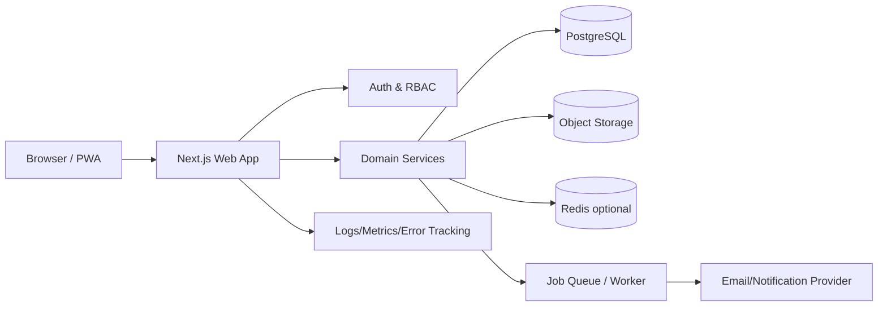

# System Architecture

## Architecture Style
**Modular Monolith** داخل Next.js application مع domain services واضحة. هذا أبسط وأكثر موثوقية لمشروع تخرج من microservices، مع إمكانية فصل workers/integrations لاحقًا.

## Layers
- Presentation: routes, layouts, server/client components.
- Application: use-cases/commands/queries.
- Domain: entities, policies, calculations, invariants.
- Infrastructure: DB, storage, email, queue, observability.

## Domain Modules
identity, projects, members, tasks, sprints, roadmap, milestones, meetings, feedback, documents, decisions, risks, health, contribution, notifications, submissions, defense, audit, admin.

## Rules
- Cross-module writes عبر application service وليس direct imports عشوائية.
- DB transactions حول workflows التي تغير أكثر من aggregate.
- Audit event created within same transaction where practical.
- Health/analytics read models يمكن تحديثها async مع freshness timestamp.

## Background Jobs
Email, digest, health snapshot, contribution snapshot, deadline reminders, file post-processing, export generation.
