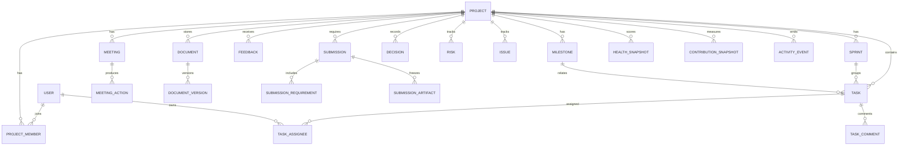

# ERD

## Relationship Rules
- كل entity operational تقريبًا project-scoped.
- document_version لا يتغير بعد إنشائه؛ upload جديد = version جديد.
- submission artifact يشير إلى version محدد وليس document mutable.
- health snapshot immutable historically.
- activity_event append-only.
