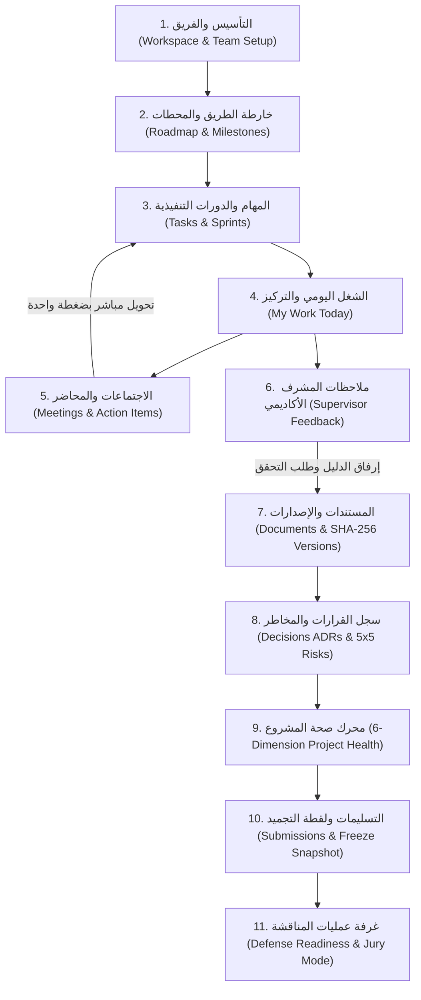

# Capstone OS — Complete User Journey & End-to-End Academic Workflow Map

**Status:** Official Product Workflow Reference  
**Target Audience:** Graduation Project Students, Team Leaders, Academic Supervisors, Department Coordinators

---

## 1. The Big Picture: Why Capstone OS Exists

Graduation projects fail or lose marks not because students lack technical ability, but because **execution is fragmented** across WhatsApp groups, scattered Google Docs (`final_v3_last.docx`), forgotten verbal supervisor remarks, and last-minute submission panic.

**Capstone OS unifies the entire academic lifecycle into a single connected loop:**

---

## 2. The 5 Macro Stages of the Interactive Workflow Map

Inside the **User Guide Center (`دليل النظام`)**, the system presents an interactive 5-stage visual map where clicking any stage reveals its connected modules, explains *why* it matters, and launches its interactive tour:

| Stage | Name (AR / EN) | Core Purpose | Linked Modules |
| :--- | :--- | :--- | :--- |
| **Stage 1** | **خطّط وقسّم (Plan & Structure)** | Define the 10 academic phases, set major deliverable milestones, and configure team roles & capacities. | `Roadmap`, `Milestones`, `Settings` |
| **Stage 2** | **نفّذ وتابع يوميًا (Execute & Sprint)** | Break milestones into actionable tasks with checklists, dependencies, and focused short sprints. | `Tasks`, `Sprints`, `My Work` |
| **Stage 3** | **اجتمع ووثّق القرارات (Meet & Decide)** | Record meeting agendas/minutes, convert action items directly into tasks, and log architectural decisions (ADRs). | `Meetings`, `Decisions`, `Activity` |
| **Stage 4** | **راجع وعالج المخاطر (Review & Mitigate)** | Resolve supervisor feedback with verifiable evidence, version official documents, and manage 5×5 risks & issues. | `Feedback`, `Documents`, `Risks & Issues`, `Project Health`, `Analytics` |
| **Stage 5** | **سلّم واستعد للمناقشة (Submit & Defend)** | Verify mandatory submission checklists, freeze immutable SHA-256 snapshots, and rehearse in Defense Mode. | `Submissions`, `Defense Hub`, `Jury Present Mode` |

---

## 3. Role-Specific Journeys

### A. Student / Team Member (`STUDENT`)
- **Primary Entry:** `My Work` (`/my-work`) & `Tasks` (`/tasks`)
- **Daily Loop:** Check assigned tasks due this week → tick checklist items → move task to `IN_REVIEW` → upload new document version → address assigned supervisor feedback → check meeting action items.
- **Role Filtering in Guide:** Never prompted to change project health formula weights, remove team members, or unfreeze a locked submission.

### B. Team Leader (`TEAM_LEADER`)
- **Primary Entry:** `Overview` (`/overview`), `Roadmap` (`/roadmap`), `Tasks` (`/tasks`), `Risks` (`/risks`), `Submissions` (`/submissions`)
- **Leadership Loop:** Monitor the 6-Dimension Health Score → inspect active drivers → assign tasks & balance workload (`Analytics`) → request supervisor approval on completed milestones → freeze official submission packages (`Freeze Snapshot`).

### C. Academic Supervisor (`SUPERVISOR`)
- **Primary Entry:** `Overview` (`/overview`), `Feedback` (`/feedback`), `Roadmap` (`/roadmap`), `Submissions` (`/submissions`)
- **Supervision Loop:** Review project health & contribution fairness (`Analytics` + Bus Factor warnings) → log structured feedback with severity (`NOTE`, `IMPORTANT`, `BLOCKING`) → verify resolved feedback with attached evidence → approve or request changes on milestones → authorize unfreezing submissions when revisions are needed.

### D. Department / System Admin (`DEPARTMENT_ADMIN` / `SYSTEM_ADMIN`)
- **Primary Entry:** `All Projects` (`/app/projects`) & `Overview`
- **Governance Loop:** Oversee active graduation projects, initiate new cohort workspaces, and audit immutable project timelines.

